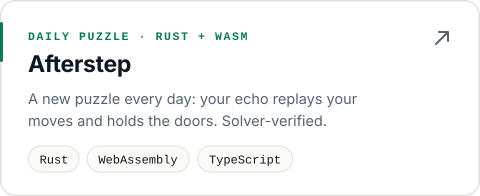
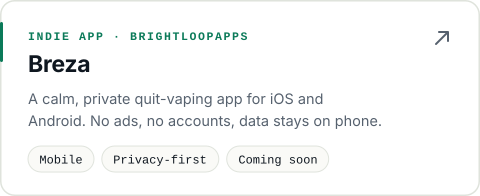
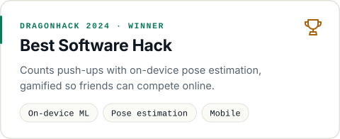
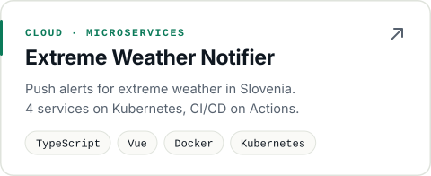
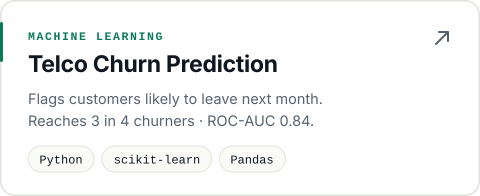
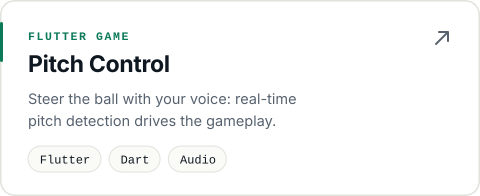

<picture>
  <source media="(prefers-color-scheme: dark)" srcset="assets/header-dark.svg">
  
</picture>

<p align="center">
  <a href="https://www.linkedin.com/in/erik-pahor/"></a>
  <a href="mailto:mutemuty1@gmail.com"></a>
  <a href="https://brightloopapps.com/"></a>
  <a href="https://lab.brightloopapps.com/"></a>
  
</p>

## 👋 Hi, I'm Erik

I build **mobile, web and AI-powered products**, from Flutter apps used in the field to TypeScript platforms where an AI assistant does the clicking for you. I've used agentic coding tools like Claude Code every day for over a year, and I review every line they write.

```ts
const erik = {
  role:       "Software Engineer",
  based:      "Nova Gorica, Slovenia 🇸🇮  (hybrid · Ljubljana)",
  experience: "4+ years · Celtra, FirstClass, RESULT, Kamino, EFOS",
  focus:      ["Mobile (Flutter)", "Front-end (React, Vue)", "AI that takes actions"],
  education:  "MSc Computer & Information Science, University of Ljubljana",
  currently:  ["Small, private apps at BrightLoopApps", "BrightLoop Lab, a lab that builds itself"],
  openTo:     ["Mobile", "Front-end", "Full-stack", "AI engineer", "Forward-deployed"],
};
```

## 🌙 BrightLoop Lab: a lab that builds itself

<a href="https://lab.brightloopapps.com/"><picture><source media="(prefers-color-scheme: dark)" srcset="assets/card-lab-dark.svg"></picture></a>

My agent pipeline, running in production. Every night a **director** agent picks the next tasks from the [issue queue](https://github.com/MuteMuty/lab/issues): my ideas, screened visitor suggestions, and polish that its own **scout** agents found. A **builder** agent opens a pull request for each task. An independent **playtester** agent then checks it on phone and desktop in a real browser. Only a pass is merged and deployed, with a live smoke test and **automatic rollback**. A command guard enforces the [safety rules](https://github.com/MuteMuty/lab/blob/main/nightshift/SAFETY.md) on every shell command, and each night ends with a [log](https://github.com/MuteMuty/lab/tree/main/nightshift/logs) and a morning report.

<p align="center">
  <a href="https://lab.brightloopapps.com/"><b>▶ Play the lab</b></a> ·
  <a href="https://github.com/MuteMuty/lab/tree/main/nightshift">How the night shift works</a> ·
  <a href="https://github.com/MuteMuty/lab/tree/main/nightshift/logs">Night logs</a> ·
  <a href="https://lab.brightloopapps.com/#suggest">Suggest an idea</a>
</p>

## 🚀 What I've shipped

| | Where | What |
|:-:|---|---|
| 🤖 | **Celtra** · Software Engineer · 2025–26 | Integrated a custom **AI assistant that operates internal TypeScript software** on users' behalf: suggested prompts, per-action 👍/👎 feedback, changes gated by **LLM-as-a-judge evals**. |
| ⚙️ | **FirstClass** · Forward Deployed Engineer · 2023–24 | Python pipeline from PDF attachments in Outlook to published reports with charts, cutting manual work by **~90%**. |
| 🚗 | **RESULT** · Mobile Developer · 2022–23 | Flutter app that insurance agencies use to **report and mark vehicle damage**, from implementation to release. |
| 🧭 | **Kamino** · Mobile Developer · 2022 | Built a **travel & ride-sharing app from scratch** in Flutter with real-time third-party data. |
| 🌾 | **EFOS** · Full-Stack Developer · 2021 | Vue + Cordova app for the **Slovenian Ministry of Agriculture**, Java EE + Oracle backend. |

## ✨ Featured work

<p align="center">
  <a href="https://afterstep.brightloopapps.com/"><picture><source media="(prefers-color-scheme: dark)" srcset="assets/card-afterstep-dark.svg"></picture></a>
  <a href="https://breza-app.com/"><picture><source media="(prefers-color-scheme: dark)" srcset="assets/card-breza-dark.svg"></picture></a>
  <picture><source media="(prefers-color-scheme: dark)" srcset="assets/card-dragonhack-dark.svg"></picture>
  <a href="https://github.com/MuteMuty/extreme-weather-event-notifier"><picture><source media="(prefers-color-scheme: dark)" srcset="assets/card-weather-dark.svg"></picture></a>
  <a href="https://github.com/MuteMuty/telco-churn"><picture><source media="(prefers-color-scheme: dark)" srcset="assets/card-churn-dark.svg"></picture></a>
  <a href="https://github.com/MuteMuty/ioi"><picture><source media="(prefers-color-scheme: dark)" srcset="assets/card-pitch-dark.svg"></picture></a>
</p>

<details>
<summary><b>More projects</b></summary>
<br>

- **[Apartment Listings](https://github.com/MuteMuty/luxonis)**: scraped real-estate listings in an ad-free React app with PostgreSQL and Docker
- **[Vectura](https://github.com/MuteMuty/vectura)**: Flutter ride-sharing app with real-time tracking, location services and maps
- **[Src](https://github.com/MuteMuty/src)**: Flutter demo web shop and marketplace
- **[Weather](https://github.com/MuteMuty/weather)**: Flutter forecast app with real-time updates and alerts
- **[Drink](https://github.com/MuteMuty/APPdrink)**: Flutter hydration tracker with reminder notifications
- **[HPC](https://github.com/MuteMuty/HPC)**: high-performance computing coursework in C++

</details>

🧪 New experiments ship every night in **[BrightLoop Lab](https://lab.brightloopapps.com/)** ([source](https://github.com/MuteMuty/lab)).

## 🛠️ Tech I work with

<p align="center">
  <picture>
    <source media="(prefers-color-scheme: dark)" srcset="https://skillicons.dev/icons?i=flutter,dart,react,vue,ts,js,nodejs,py,java,cpp,rust,postgres,firebase,docker,git,githubactions&perline=8&theme=dark">
    
  </picture>
</p>

<p align="center"><sub>Plus: Bloc · React Native · Material UI · REST APIs · Oracle DB · Java EE · Claude Code &amp; agentic workflows · LLM tool use</sub></p>

<p align="center"><sub>Hiring for mobile, front-end or AI work? <a href="mailto:mutemuty1@gmail.com">Let's talk</a>.</sub></p>
