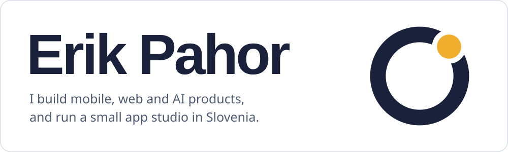
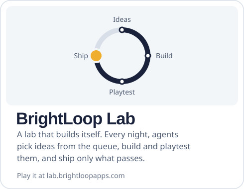
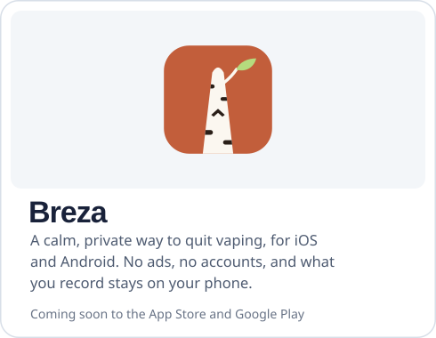
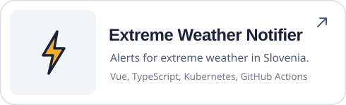
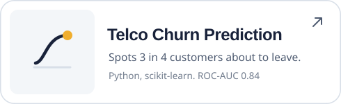

<picture><source media="(prefers-color-scheme: dark)" srcset="assets/hero-dark.svg"></picture>

**Open to work from December 2026** as a mobile, front-end, full-stack or AI engineer. Reach me on [LinkedIn](https://www.linkedin.com/in/erik-pahor/) or at [mutemuty1@gmail.com](mailto:mutemuty1@gmail.com).

I've spent four years shipping Flutter apps used in the field, Vue and React front-ends, and most recently an AI assistant that operates software for its users. I use agentic tools like Claude Code every day and review every line they write. MSc in Computer and Information Science from the University of Ljubljana; based in Nova Gorica, hybrid in Ljubljana.

## Now

  <a href="https://lab.brightloopapps.com/"><picture><source media="(prefers-color-scheme: dark)" srcset="assets/now-lab-dark.svg"></picture></a>
  <a href="https://breza-app.com/"><picture><source media="(prefers-color-scheme: dark)" srcset="assets/now-breza-dark.svg"></picture></a>

The lab runs in production. Each night a director agent plans the work, builder agents open pull requests, an independent playtester checks every one in a real browser, and only a pass is deployed, with automatic rollback. [See how it works](https://github.com/MuteMuty/lab#how-it-works), or play [Afterstep](https://afterstep.brightloopapps.com/), its daily puzzle.

## Experience

| | | |
|---|---|---|
| 2025–26 | **Celtra** Software engineer | Built a custom AI assistant that operates internal TypeScript software for its users, with suggested prompts, per-action feedback and changes gated by LLM-as-a-judge evals. |
| 2023–24 | **FirstClass** Forward-deployed engineer | Built a Python pipeline that turns PDF attachments in Outlook into published reports with charts, cutting manual work by about 90%. |
| 2022–23 | **RESULT** Mobile developer | Took a Flutter app that insurance agencies use to report and mark vehicle damage from first commit to release. |
| 2022 | **Kamino** Mobile developer | Built a travel and ride-sharing app in Flutter from scratch, on real-time third-party data. |
| 2021 | **EFOS** Full-stack developer | Built a Vue and Cordova app for the Slovenian Ministry of Agriculture, with a Java EE and Oracle backend. |

## Projects

  <picture><source media="(prefers-color-scheme: dark)" srcset="assets/project-dragonhack-dark.svg"></picture>
  <a href="https://github.com/MuteMuty/extreme-weather-event-notifier"><picture><source media="(prefers-color-scheme: dark)" srcset="assets/project-weather-dark.svg"></picture></a>
  <a href="https://github.com/MuteMuty/telco-churn"><picture><source media="(prefers-color-scheme: dark)" srcset="assets/project-churn-dark.svg"></picture></a>
  <a href="https://github.com/MuteMuty/ioi"><picture><source media="(prefers-color-scheme: dark)" srcset="assets/project-pitch-dark.svg"></picture></a>

More projects

 

- **[Apartment Listings](https://github.com/MuteMuty/luxonis)**: scraped real-estate listings in an ad-free React app with PostgreSQL and Docker
- **[Vectura](https://github.com/MuteMuty/vectura)**: Flutter ride-sharing app with real-time tracking and maps
- **[Src](https://github.com/MuteMuty/src)**: Flutter demo web shop and marketplace
- **[Weather](https://github.com/MuteMuty/weather)**: Flutter forecast app with real-time updates and alerts
- **[Drink](https://github.com/MuteMuty/APPdrink)**: Flutter hydration tracker with reminders
- **[HPC](https://github.com/MuteMuty/HPC)**: high-performance computing coursework in C++

**Tools I use most:** Flutter and Dart, TypeScript with React and Vue, Python, Rust and WebAssembly, PostgreSQL, Docker and Kubernetes, and LLM tool use with evals.

Images are generated by [scripts/gen-profile.py](scripts/gen-profile.py). Names are set in Bricolage Grotesque ([SIL OFL](assets/fonts/BricolageGrotesque-OFL.txt)).
