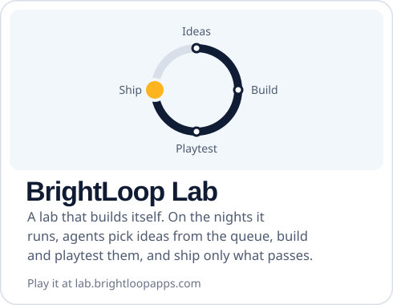
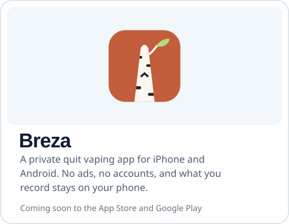
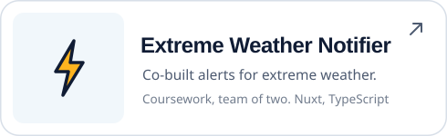

<picture><source media="(prefers-color-scheme: dark)" srcset="assets/hero-dark.svg"></picture>

Reach me on [LinkedIn](https://www.linkedin.com/in/erik-pahor/) or at [mutemuty1@gmail.com](mailto:mutemuty1@gmail.com).

I've spent four years shipping Flutter apps used in the field, Vue and React front-ends, and most recently an AI assistant that operates software for its users. I use agentic tools like Claude Code every day and review every line they write. MSc in Computer and Information Science from the University of Ljubljana; based in Nova Gorica, Slovenia.

## Now

  <a href="https://lab.brightloopapps.com/"><picture><source media="(prefers-color-scheme: dark)" srcset="assets/now-lab-dark.svg"></picture></a>
  <a href="https://breza-app.com/"><picture><source media="(prefers-color-scheme: dark)" srcset="assets/now-breza-dark.svg"></picture></a>

The lab is in production. On the nights it runs, a director agent plans the work, builder agents open pull requests, an independent playtester checks each one in a real browser, and only a pass is deployed, with automatic rollback. It first ran on 11 Nov 2026. I designed and built the loop; agents write most of the project code, and I set the queue and review what they flag. [See how it works](https://github.com/MuteMuty/lab#how-it-works), or play [Afterstep](https://afterstep.brightloopapps.com/), its daily puzzle.

## Experience

**Celtra** &nbsp;Software Engineer, 2025 – 2026 
Integrated a custom AI assistant into Celtra's internal TypeScript software as part of a team. My part was the integration and extending what it could do, including suggested prompts. Changes to the assistant were gated by LLM-as-a-judge evals, and users could rate each action it took.

**FirstClass** &nbsp;Forward Deployed Engineer, 2023 – 2024 
Built a Python pipeline that turns PDF attachments in Outlook into published reports with charts, cutting manual work by about 90%.

**RESULT** &nbsp;Mobile Application Developer, 2022 – 2023 
Built features for a Flutter app that insurance agencies use to report and mark vehicle damage, and took them through to release.

**Kamino** &nbsp;Mobile Application Developer, 2022 
Built a travel and ride-sharing app in Flutter from scratch, on real-time third-party data.

**EFOS** &nbsp;Full-Stack Developer, 2021 
Built a Vue and Cordova app for the Slovenian Ministry of Agriculture, with a Java EE and Oracle backend.

## Projects

  <picture><source media="(prefers-color-scheme: dark)" srcset="assets/project-dragonhack-dark.svg"></picture>
  <a href="https://github.com/MuteMuty/extreme-weather-event-notifier"><picture><source media="(prefers-color-scheme: dark)" srcset="assets/project-weather-dark.svg"></picture></a>
  <a href="https://github.com/MuteMuty/telco-churn"><picture><source media="(prefers-color-scheme: dark)" srcset="assets/project-churn-dark.svg"></picture></a>
  <a href="https://github.com/MuteMuty/pitch-control"><picture><source media="(prefers-color-scheme: dark)" srcset="assets/project-pitch-dark.svg"></picture></a>

More projects

 

- **[Apartment Listings](https://github.com/MuteMuty/apartment-listings)**: a take-home task. Scrapes apartment listings into PostgreSQL and shows them in an ad-free React app, all started with Docker Compose
- **[Vectura](https://github.com/MuteMuty/vectura)**: Flutter ride-sharing app to offer, search and join rides, with maps and Bloc
- **[Flutter Web Shop](https://github.com/MuteMuty/flutter-web-shop)**: mock shopping app on the DummyJSON API, with search, cart and user switching
- **[Weather](https://github.com/MuteMuty/weather)**: Flutter forecast app with real-time updates and alerts
- **[Drink](https://github.com/MuteMuty/APPdrink)**: Flutter hydration tracker with reminders

**Tools I use most:** Flutter and Dart, TypeScript with React and Vue, Python, Rust, PostgreSQL, Docker, Cloudflare Workers, and LLM tool use with evals.

Images are generated by [scripts/gen-profile.py](scripts/gen-profile.py). Names are set in Bricolage Grotesque ([SIL OFL](assets/fonts/BricolageGrotesque-OFL.txt)).
